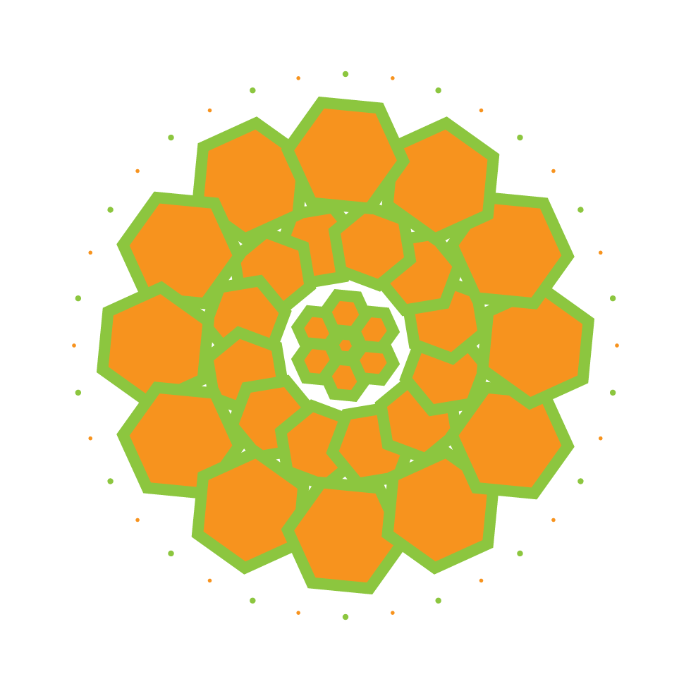
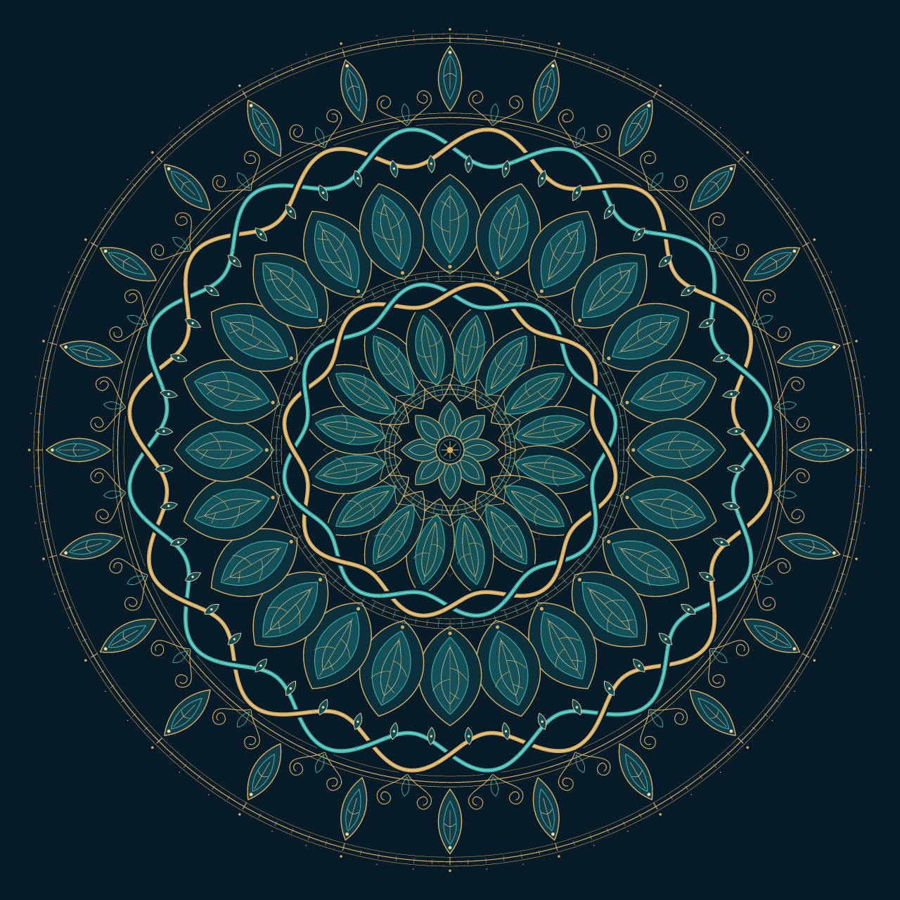
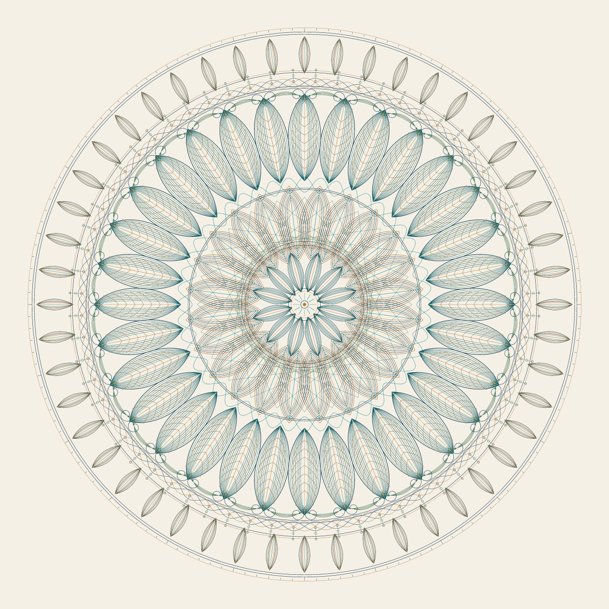
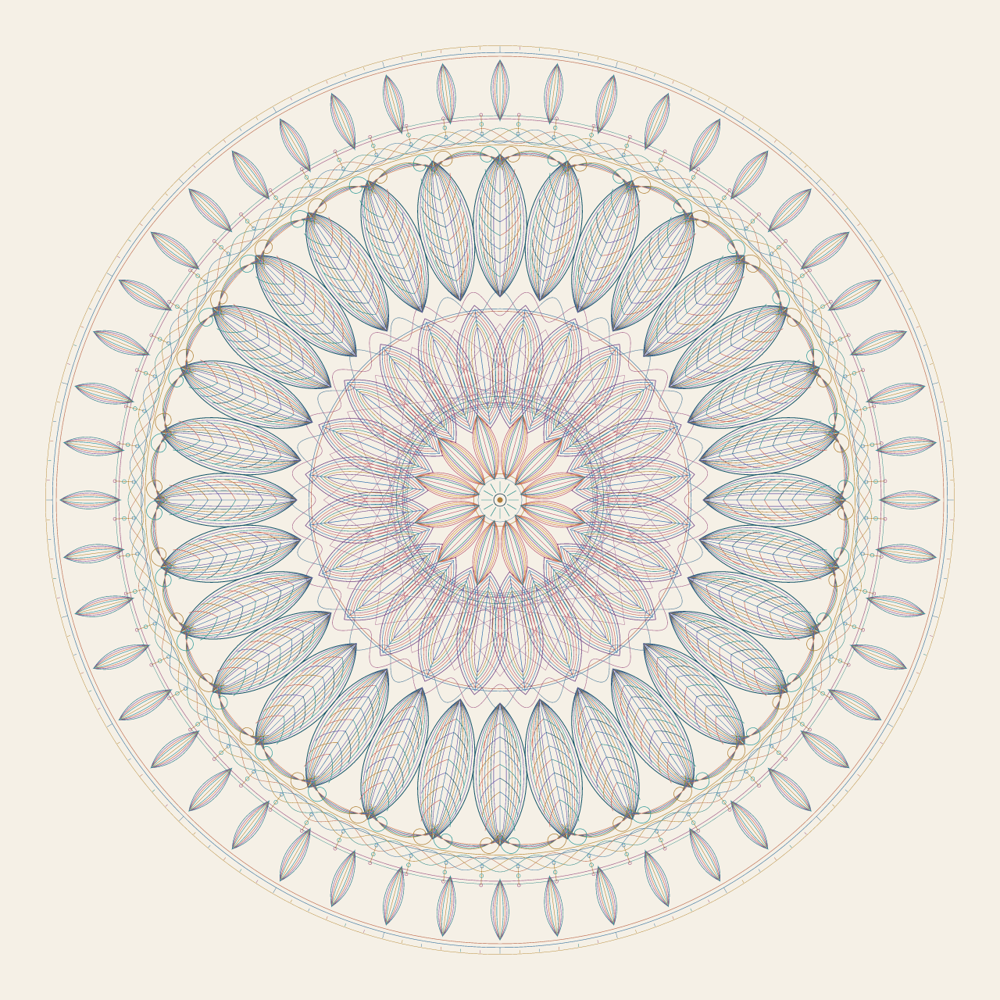

# Gesicherte eigene Mandalas

Die folgenden Dateien dürfen als eigene Projektarbeit veröffentlicht werden. Die externe Vorlage und ihre direkte Rekonstruktion sind bewusst nicht Teil dieser Galerie.

## Sonnenrosette

31 verknüpfte Instanzen des ursprünglichen Projektmotivs, versetzte Ringe, kleines Zentrum und Punktekranz. Die erste erfolgreiche direkte Wortbefehl-Konstruktion wurde vom Anwender bestätigt.

[Native Datei](../artwork/KI-Mandala-Sonnenrosette.vectorcraft) · [SVG](../artwork/KI-Mandala-Sonnenrosette.svg)

## Aurelia

Gold und Türkis auf Dunkelblau. Flechtbänder mit insgesamt 40 konstruierten Kreuzungen, Lotuskränze, Arabesken und eine fein gegliederte Mitte. 1.356 native Elemente laut Engine-Inspektion. **Diese Zeichnung besteht aus Pfaden und Gruppen, nicht aus gemeinsam verknüpften Symbolmotiven.** „Aurelia“ ist nur der Bildname.

[Native Datei](../artwork/KI-Mandala-Aurelia.vectorcraft) · [SVG](../artwork/KI-Mandala-Aurelia.svg)

## Liniara

Feines Linienmandala auf hellem Grund. Die sechs gemeinsam bearbeitbaren Definitionen sind:

| Symbolfamilie | Instanzen |
|---|---:|
| Federfächer · Linien | 32 |
| Spitzbogen · Maßwerk | 24 |
| Kernblatt · Linien | 12 |
| Randlanzette | 48 |
| Bogenbrücke · Arabeske | 32 |
| Perlenachse | 64 |
| **Gesamt** | **212** |

[Native Datei](../artwork/KI-Mandala-Liniara.vectorcraft) · [SVG](../artwork/KI-Mandala-Liniara.svg)

## Liniara – Farbenspiel

Erweiterte Palette aus Petrol, Koralle, Violett, Blau und Gold. Die sechs Definitionen und 212 Instanzen bleiben erhalten. Die Farbübernahme wurde in einer nativen Dokumentkopie vorgenommen; die gespeicherten Pfadkoordinaten und Instanztransformationen wurden nicht verändert.

[Native Datei](../artwork/KI-Mandala-Liniara-Farben.vectorcraft) · [SVG](../artwork/KI-Mandala-Liniara-Farben.svg)
